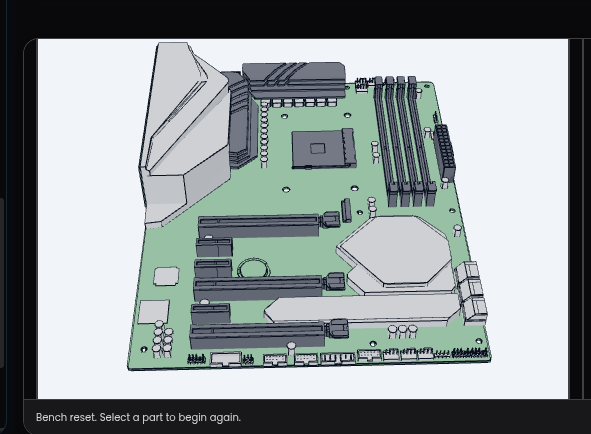
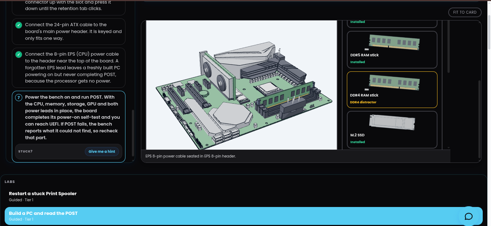
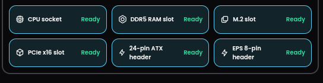
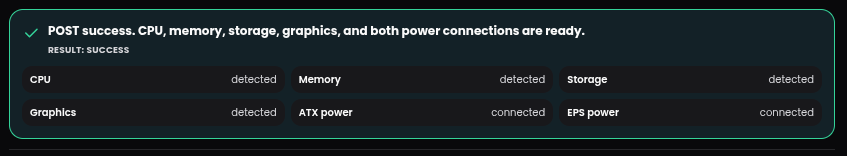

# PC Assembly and POST (Power-On Self-Test)

Lab information

| Field | Details |
|---|---|
| Category | Hardware Troubleshooting |
| Lab | Build a PC and Read the POST |
| Platform | Revy's Tech Journey |
| Environment | RTJ Hardware Bench – Canned Simulation |
| Difficulty | Beginner |
| Status | Completed |
| Result | Successful POST |

## 1. Lab Objectives

The objectives of this exercise were to:

- Identify major motherboard components and their functions.
- Understand CPU, RAM, storage and graphics installation.
- Identify motherboard power connectors.
- Understand the Power-On Self-Test (POST).
- Verify hardware detection and power connectivity through a simulated POST.

## 2. Initial Hardware Inspection

The initial motherboard inspection involved identifying the following components and connection points:

- CPU socket
- DDR5 RAM slots
- M.2 storage slot
- PCIe x16 expansion slot
- 24-pin ATX power header
- EPS 8-pin CPU power header

The simulator initially showed the component slots as empty.

## 3. Hardware Installation

The simulation involved fitting the required components into their corresponding motherboard locations.

The installation included:

1. CPU installation into the motherboard socket.
2. DDR5 RAM installation into the memory slot.
3. M.2 storage installation.
4. Graphics card installation into the PCIe x16 slot.
5. Connecting the 24-pin ATX motherboard power.
6. Connecting the EPS 8-pin CPU power.

The simulator subsequently reported all six installation and connection checks as **Ready**.

## 4. Understanding POST

POST stands for Power-On Self-Test.

It is a hardware initialization and diagnostic process performed by system firmware during startup.

POST checks and initializes essential hardware before the computer proceeds to the boot process.

Examples of hardware checked during this process include:

- Central Processing Unit (CPU)
- Random Access Memory (RAM)
- Graphics hardware
- Storage devices
- Essential motherboard and power connections

POST results may be communicated through firmware messages, diagnostic LEDs, beep codes or other motherboard-specific indicators.

## 5. POST Results

After completing the simulated assembly, I executed the POST test using the RTJ Hardware Bench.

The simulator returned the following results:

| Component / Check | Result |
|---|---|
| CPU | Detected |
| Memory | Detected |
| Storage | Detected |
| Graphics | Detected |
| 24-pin ATX power | Connected |
| EPS 8-pin power | Connected |

**Overall result: SUCCESS**

The simulator displayed:

> POST success. CPU, memory, storage, graphics, and both power connections are ready.

## 6. Troubleshooting and Diagnosis

The exercise demonstrated the importance of checking component installation and motherboard power connections before attempting POST.

The six hardware checks were all marked Ready before the POST test was executed.

No unresolved hardware installation or power-connection errors were reported by the simulator.

## 7. Final Verification

The final POST test was successful.

The following conditions were confirmed:

- CPU successfully detected.
- Memory successfully detected.
- Storage successfully detected.
- Graphics successfully detected.
- Main motherboard power connected.
- CPU power connected.

The simulated system successfully completed POST.

## 8. Lessons Learned

1. Correct CPU orientation and installation are important when assembling a motherboard.
2. DDR5 memory must be installed in compatible motherboard slots.
3. M.2 storage devices and PCIe expansion cards use different motherboard interfaces.
4. The 24-pin ATX connector provides the motherboard's main power.
5. The EPS 8-pin connector supplies power to the CPU voltage regulation circuitry.
6. Missing or incorrectly connected hardware can prevent successful POST.
7. POST is an important first diagnostic stage when troubleshooting a computer that fails to start.
8. POST in full means Power-On-Self-Test

## 9. Evidence

The following screenshots were captured during the Revy's Tech Journey simulation.

## 10. Lab Conclusion

This exercise provided practical exposure to desktop PC assembly concepts and the Power-On Self-Test process.

The simulation successfully detected the CPU, memory, storage and graphics hardware and confirmed that both motherboard power connections were ready.

This lab strengthened my understanding of motherboard components, hardware interfaces, power connections and the importance of POST in initial hardware troubleshooting.

**Environment note:** This exercise was performed using Revy's Tech Journey's simulated hardware bench. It was not a physical PC assembly.

