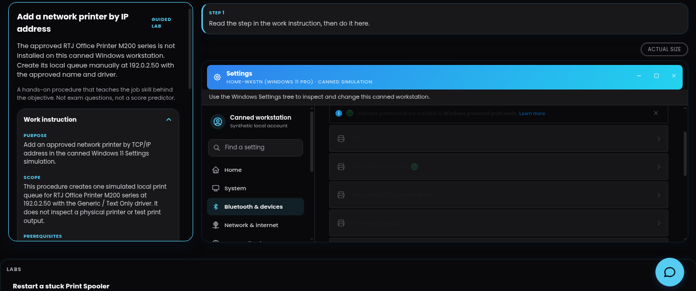
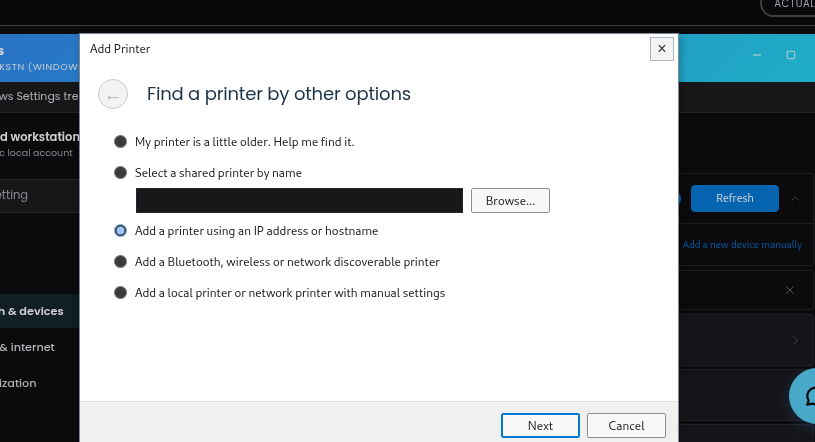
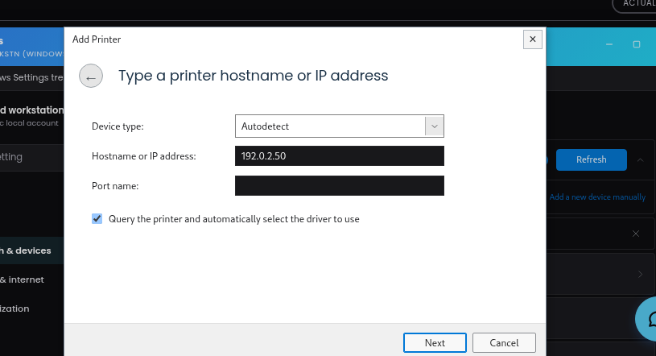
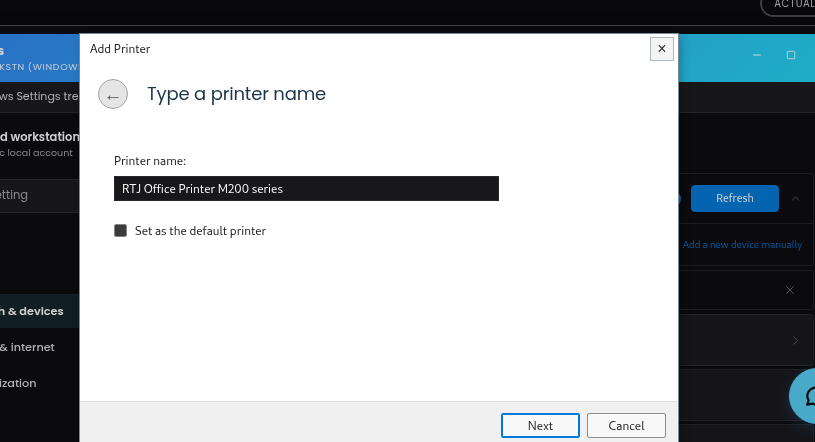
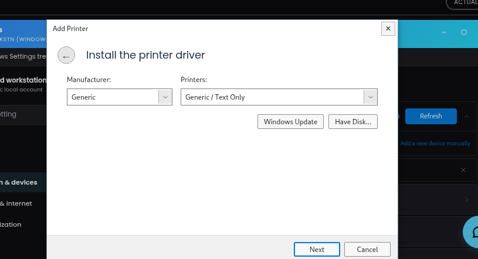
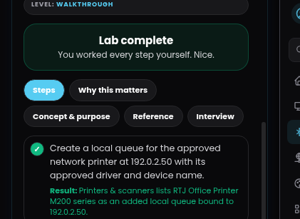

# Add a Network Printer by IP Address (Windows 11)

A hands-on, simulated IT support laboratory demonstrating how to manually create a local print queue for a network printer using its IP address, specific driver assignment, and custom naming conventions within a Windows 11 environment.

## 📋 Lab Overview

- **Certification Alignment:** CompTIA A+ Core 1 (220-1201) & Core 2 (220-1202)
- **Difficulty Level:** Walkthrough (Tier 1)
- **Environment:** Canned Windows 11 Pro Simulation (`HOME-WKSTN`)
- **Objective:** Install the **RTJ Office Printer M200 series** manually using its static IP address.

---

## 🛠️ Work Instruction Parameters

| Parameter | Value |
| :--- | :--- |
| **Target Device Address** | `192.0.2.50` |
| **Approved Printer Name** | `RTJ Office Printer M200 series` |
| **Approved Driver** | `Generic / Text Only` |
| **Sharing Status** | Unshared |

### 🔓 Prerequisites
* Administrator rights on the target Windows workstation.
* Network configuration documentation confirming the static IP of the device.

---

## ⚠️ Policy, Safety & Constraints

* **Strict Adherence:** Use only the approved IP address, name, and driver specified above.
* **IP Restrictions:** Do not substitute `192.0.2.99`. Within this simulation, that address is configured as unreachable and will trigger a "not-found" error.
* **Real-World Best Practice:** Successful execution of the wizard in this simulation confirms reachability, but does not prove physical hardware functionality. On a production machine, always follow these steps with a **Driver Verification** and a **Test Page Print** before closing the service ticket.

---

## 🚀 Execution Steps (Simulation Workflow)

### Step 1: Open Printers & Scanners
1. Navigate to the **Windows Settings** tree.
2. Click on **Bluetooth & devices** from the left-hand navigation pane.
3. Select **Printers & scanners** from the options list.

### Step 2: Initialize Printer Discovery
1. Locate the **Add a printer or scanner** section at the top of the interface.
2. Click the **Add device** button to prompt Windows to scan the network.

### Step 3: Add Manually via IP Address
1. Wait for the discovery scan to complete or display the manual option.
2. Select the option stating **"The printer that I want isn't listed"** (or click the manual installation link).
3. Choose **Add a printer using an IP address or hostname** and click Next.

### Step 4: Configure Device Settings
1. Set the Device Type to **TCP/IP Device**.
2. Enter the approved IP address: `192.0.2.50` in the **Hostname or IP address** field.
3. Uncheck *“Query the printer and automatically select the driver to use”* if necessary to manually enforce policy. Click Next.

### Step 5: Assign Driver & Naming Convention
1. In the Manufacturer column, select **Generic**.
2. In the Printers column, select **Generic / Text Only** driver. Click Next.
3. Replace the default name with the strict corporate name: **`RTJ Office Printer M200 series`**.
4. Complete the wizard ensuring that **Do not share this printer** is selected.

---

## ✅ What Success Looks Like
The operation is complete when the **Printers & scanners** list contains a newly populated, unshared local queue explicitly named `RTJ Office Printer M200 series`, successfully bound to `192.0.2.50` utilizing the `Generic / Text Only` driver framework.

## Preview / Evidence

